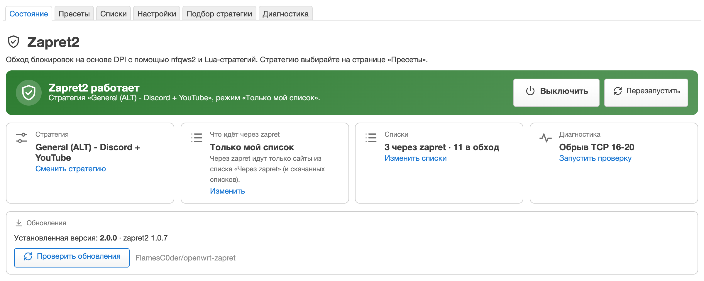
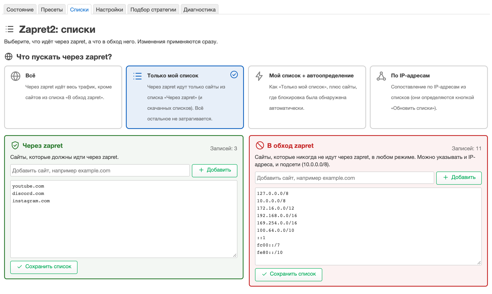
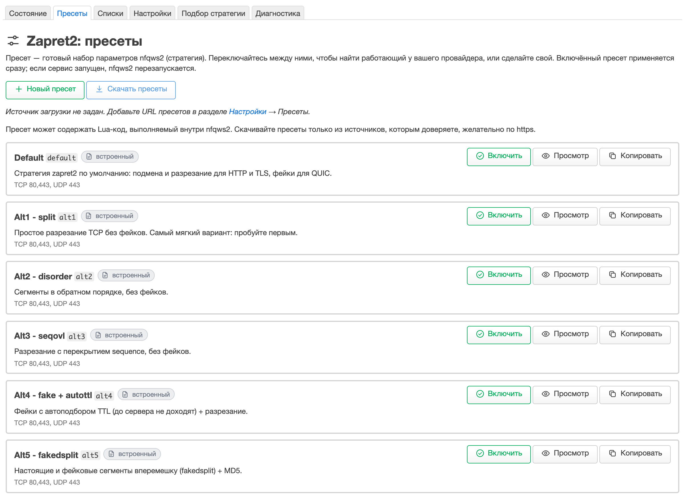
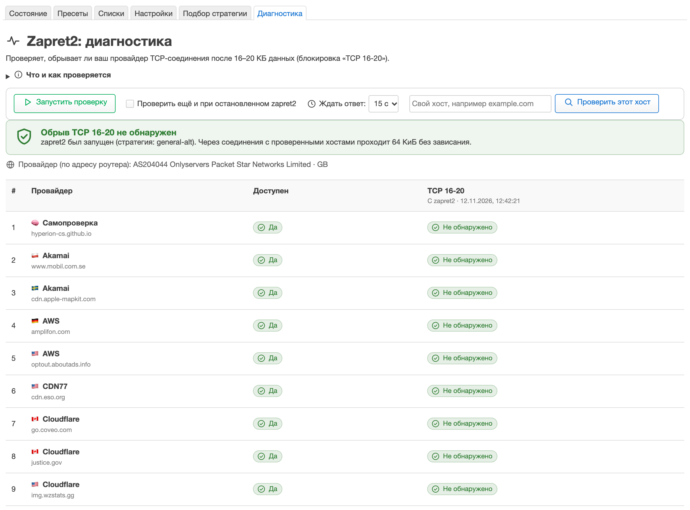

# openwrt-zapret

Обход блокировок на роутере с **OpenWrt**: порт [zapret2](https://github.com/bol-van/zapret2) с удобным веб-интерфейсом
в LuCI. Включается одной кнопкой, стратегии переключаются из списка, а какие сайты пускать через обход, а какие мимо —
настраивается в двух полях.

<p align="center">
  
</p>

## Возможности

* **Включение одной кнопкой** и понятное состояние: работает, выключен, не запустился.
* **12 готовых стратегий** (пресетов) — переключаются в один клик; можно сделать свою или скачать чужую.
* **Два списка рядом:** «Через zapret» и «В обход zapret». Сайт добавляется одной строкой, адрес можно вставить целиком.
* **Диагностика:** проверка, не обрывает ли провайдер соединения после 16–20 КБ данных (метод проекта dpi-checkers).
* **Обновление одной командой** из последнего релиза и проверка новой версии прямо в интерфейсе.
* Интерфейс на русском и английском.

## Установка

Нужен роутер с OpenWrt **24.10** или **25.12** и доступ по SSH. Выполните на роутере:

```sh
wget -O - https://github.com/FlamesC0der/openwrt-zapret/releases/latest/download/install.sh | sh
```

Скрипт сам определит архитектуру роутера, скачает пакеты из **последнего релиза**, проверит контрольные суммы и
установит всё. Той же командой вы обновляетесь на новую версию; настройки и списки сохраняются.

<details>
<summary>Установить вручную или по-другому</summary>

* Файлы лежат на странице [Releases](https://github.com/FlamesC0der/openwrt-zapret/releases/latest). Нужны три пакета:
  `zapret2` для вашей архитектуры (её показывает `cat /etc/openwrt_release`, строка `DISTRIB_ARCH`), `luci-app-zapret2`
  и, по желанию, `luci-i18n-zapret2-ru` (русский перевод). Скопируйте их на роутер в `/tmp` и выполните:
  * OpenWrt 24.10: `opkg install /tmp/zapret2_*.ipk /tmp/luci-app-zapret2_*.ipk /tmp/luci-i18n-zapret2-ru_*.ipk`
  * OpenWrt 25.12: `apk add --allow-untrusted /tmp/zapret2-*.apk /tmp/luci-app-zapret2-*.apk /tmp/luci-i18n-zapret2-ru-*.apk`
* Только скачать и проверить, ничего не устанавливая: `ZAPRET_NO_INSTALL=1`, без русского перевода: `ZAPRET_NO_RU=1`
  (переменные ставятся перед `sh`: `... | ZAPRET_NO_RU=1 sh`).
* Другая версия OpenWrt (например, 23.05) или архитектура, которой нет в релизе: соберите пакеты сами —
  [docs/DEVELOPMENT.md](docs/DEVELOPMENT.md).
* Если на роутере стоит старая первая версия порта (пакеты `zapret`, `luci-app-zapret`), сначала удалите её:
  `opkg remove luci-app-zapret luci-i18n-zapret-ru zapret`. Её настройки не переносятся.

</details>

## Первый запуск

1. Откройте LuCI: **Службы → Zapret2** и нажмите **«Включить»**.
2. На вкладке **«Пресеты»** выберите стратегию. Начните с **Default**; если часть сайтов перестала открываться,
   попробуйте **Alt1**, **Alt2**, **Alt3** (они без фейковых пакетов). Для Discord и YouTube — **General (ALT)**.
3. На вкладке **«Списки»** выберите режим и добавьте сайты. Проще всего режим **«Только мой список»**: через zapret идут
   лишь сайты из списка «Через zapret», остальное работает как обычно.
4. Что-то пошло не так — нажмите **«Выключить»**: роутер сразу вернётся к обычной работе.

Пресеты — это **отправные точки, а не гарантия обхода**: что сработает, зависит от вашего провайдера. Попробуйте
несколько, а для подбора есть вкладка **«Подбор стратегии»**.

<table>
<tr>
<td width="50%"><br><sub><b>Списки.</b> Режим и два списка рядом.</sub></td>
<td width="50%"><br><sub><b>Пресеты.</b> Готовые стратегии с короткими описаниями.</sub></td>
</tr>
</table>

## Стратегии

| Пресет | Для чего |
|---|---|
| **Default** | стратегия zapret2 по умолчанию: подмена и разрезание для HTTP и TLS, фейки для QUIC |
| **Alt1** | простое разрезание TCP без фейков — самый мягкий, пробуйте первым |
| **Alt2** / **Alt3** | сегменты в обратном порядке / разрезание с перекрытием, без фейков |
| **Alt4** – **Alt6** | варианты с фейковыми пакетами и сегментами |
| **Alt7** | данные в SYN + разрезание; действует на весь TLS, списки не учитываются |
| **Auto** | перебирает стратегии по кругу, пока сайт не открывается |
| **Discord + YouTube** | Default + голос Discord (UDP 50000-50100) |
| **General (ALT)** | порт «general (ALT)» из [zapret-discord-youtube](https://github.com/Flowseal/zapret-discord-youtube): Discord, YouTube; сам скачивает списки |
| **General (ALT) + порты 1024-65535** | то же и весь TCP/UDP на высоких портах (игры); **нагружает роутер** |

Подробности, формат файла пресета и как сделать свой — в [docs/PRESETS.md](docs/PRESETS.md).

> **General (ALT)** подменяет TCP timestamp в фейках, поэтому на устройстве должны быть включены TCP timestamps: на
> Android, iOS, macOS и Linux они включены, а в Windows выполните `netsh interface tcp set global timestamps=enabled`.

## Диагностика

Вкладка **«Диагностика»** проверяет, не обрывает ли ваш провайдер TCP-соединения к зарубежным хостингам и CDN после
16–20 КБ данных (из-за этого сайты открываются наполовину, а загрузки зависают). Нажмите «Запустить проверку» — через
минуту будет таблица по 36 хостам. Можно сравнить результат с включённым и выключенным zapret2 или проверить свой хост.

<p align="center">
  
</p>

## Частые вопросы

**Сайты перестали открываться.** Нажмите «Выключить» и смените пресет на Alt1, Alt2 или Alt3 — они не используют
фейки. С фейковыми пакетами (Default, Alt4–Alt6, General) часть сайтов и серверов может не работать.

**Включено, но ничего не меняется.** Посмотрите баннер на вкладке «Состояние»: он покажет, запущен ли zapret2. В
режиме «Только мой список» обрабатываются только сайты из списка «Через zapret»; режим «Всё» обрабатывает всё, кроме
списка «В обход». Помните: zapret2 не снимает блокировку IP-адреса, он обходит блокировку по содержимому (DPI).

**Как обновиться.** Выполните ту же команду установки. Кнопка «Проверить обновления» на вкладке «Состояние» покажет,
вышла ли новая версия.

**Как удалить.** `opkg remove luci-i18n-zapret2-ru luci-app-zapret2 zapret2` (OpenWrt 24.10) или
`apk del luci-i18n-zapret2-ru luci-app-zapret2 zapret2` (25.12). Настройки и списки остаются в `/etc/zapret2`;
чтобы стереть и их, удалите этот каталог и `/etc/config/zapret2`.

**Интерфейс на английском.** Выберите русский язык в *Система → Система → Язык и стиль* и убедитесь, что установлен
пакет `luci-i18n-zapret2-ru`.

**В релизе нет файла для моего роутера.** Соберите пакеты сами — [docs/DEVELOPMENT.md](docs/DEVELOPMENT.md) — или
напишите в Issues, какая у вас архитектура (`DISTRIB_ARCH` из `/etc/openwrt_release`).

Журнал: `logread -e zapret2`; итоговая конфигурация: `/etc/zapret2/config`; правила: `nft list table inet zapret2`.

## Документация

* [docs/PRESETS.md](docs/PRESETS.md) — пресеты и списки: формат, режимы, General (ALT), свои пресеты.
* [docs/DEVELOPMENT.md](docs/DEVELOPMENT.md) — сборка, выпуск релизов, как всё устроено, что проверено и что нет.

## Лицензия и благодарности

Код порта — MIT, см. [LICENSE](LICENSE). Сам [zapret2](https://github.com/bol-van/zapret2) (bol-van, MIT) скачивается
при сборке и в репозитории не хранится. Списки и стратегия General (ALT) — проект
[zapret-discord-youtube](https://github.com/Flowseal/zapret-discord-youtube) (Flowseal); метод и список хостов
диагностики — [dpi-checkers](https://github.com/hyperion-cs/dpi-checkers) (hyperion-cs, Apache-2.0).
